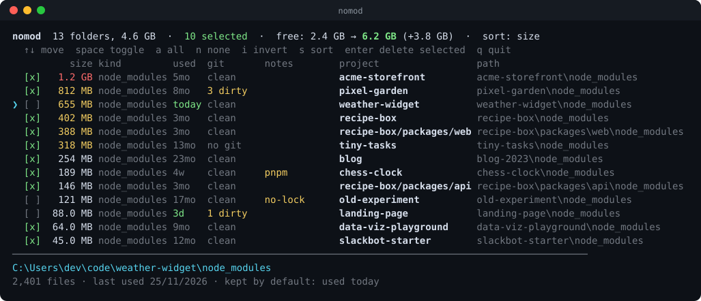

# nomod-cli

Find every `node_modules` folder on your machine, see how much space each one takes, and delete the ones you don't need. You can reinstall them later with `npm install`.

No dependencies. Needs Node 20 or newer. Works on Windows, macOS and Linux.



## Install

```sh
npm install -g nomod-cli
```

Or run it once without installing:

```sh
npx nomod-cli
```

## Use

```sh
nomod                 # scan your user folder and pick what to delete
nomod ~/projects      # scan one folder instead
nomod --dry-run       # just show the list and sizes, delete nothing
```

nomod scans, then opens a checklist sorted by size (as in the picture above):

| Key | Action |
| --- | --- |
| `↑` `↓` | move |
| `space` | check / uncheck |
| `a` / `n` / `i` | check all / none / invert |
| `s` | sort by size, last used or path |
| `enter` | delete the checked folders (asks you to confirm first) |
| `q` / `esc` | quit without deleting |

The header shows how much free space you'll have after deleting what's checked.

The columns:

- **used**: when you last worked on the project (its newest file or git commit).
- **git**: `clean` means nothing uncommitted. `4 dirty` means 4 files with uncommitted changes, which is a hint you left work in progress there. `no git` means the project isn't in a repo. It's for information only and doesn't change what starts checked: deleting `node_modules` never touches your code. A repo whose `.gitignore` doesn't list `node_modules` shows `1 dirty` from `node_modules` alone.
- **notes**: why a folder might not reinstall cleanly (see below). `pnpm` means it shares a store, so it frees less than its size (`pnpm store prune` frees the rest).
- **project**: the repo's name on its remote (e.g. GitHub), with a sub-path for packages inside a repo (`recipe-box/web`). Repos with no remote use their folder name.

## What starts checked

Everything starts checked except:

- projects you used in the last 14 days (change this with `--recent <days>`)
- `node_modules` with no lockfile next to it, because a reinstall may not give you the same versions
- `node_modules` with no `package.json` next to it

The line under the list says why the highlighted row is unchecked.

## Options

| Option | What it does |
| --- | --- |
| `-n`, `--dry-run` | list and size only |
| `-a`, `--all` | also list build and cache folders (`.next`, `.nuxt`, `.turbo`, `.svelte-kit`, `.cache`, `dist`, `build`, `coverage`…) and Python virtualenvs |
| `-r`, `--recent <days>` | how recent counts as "still in use" (default 14) |
| `-m`, `--min <MB>` | hide folders smaller than this |
| `-x`, `--exclude <regex>` | skip matching paths (you can repeat it) |
| `-p`, `--pick <regex>` | check only the folders whose path matches, ignoring the defaults |
| `-y`, `--yes` | skip the confirmation. With no terminal, deletes what starts checked |
| `--json` | print the scan as JSON |
| `-h`, `--help` | show help |
| `-v`, `--version` | show the version |

## For AI agents and scripts

Point your agent at [llms.txt](llms.txt). In short:

```sh
nomod --json                          # scan as JSON, delete nothing
nomod --json --yes                    # delete the checked folders, JSON result
nomod --json --yes --pick 'old-app'   # delete only the folders whose path matches
```

Without a terminal and without `--yes`, nomod only prints a report.

## Safe by design

- It only deletes folders with these names: `node_modules`, the `--all` build folders, and virtualenvs.
- It never follows symlinks or junctions, so pnpm's shared store is left alone.
- It skips `AppData`, dot-folders (`.vscode`, `.npm`…) and system folders, so editor extensions and global installs are never touched.
- `dist`, `build` and `coverage` are never listed if git tracks them.

Exit codes: `0` done, `1` error, `2` nothing found, `3` cancelled.
## License

MIT
